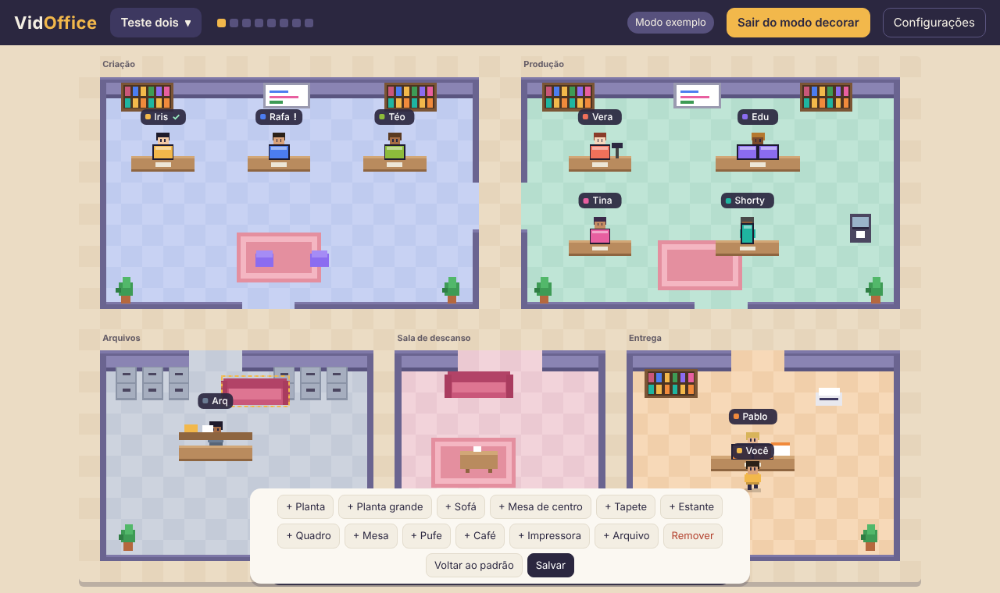

# VidOffice

Um escritório virtual em pixel art onde cada etapa de um vídeo de YouTube tem um funcionário: ideias, roteiro, título, voz, edição, miniatura, shorts e publicação. Você anda pelo escritório, conversa com cada um, dá ordens, pede ajustes e aprova o que ficou bom.



> Projeto pessoal em desenvolvimento, licença MIT. Só biblioteca padrão do Python, sem dependências.

## Status: Fase 1 (local)

Roda só no seu computador. Nada é enviado para servidor nenhum, exceto os pedidos de texto à IA (se você colocar uma chave).

| Funcionário | O que faz hoje |
|---|---|
| Iris (ideias), Rafa (roteiro), Téo (título e descrição) | Escrevem com IA. Cada pedido gera uma **versão**; você aprova, edita à mão ou pede ajuste. |
| Vera (voz), Edu (edição), Tina (miniatura), Shorty (shorts) | Escrevem o **plano** (roteiro de gravação, lista de cortes, briefing da miniatura, trechos para shorts). A parte de áudio/vídeo/imagem entra nas próximas fases. |
| Arq (arquivos) | Pastas por projeto: roteiro, áudio, vídeo, miniaturas, shorts, entrega. Envio por arrastar e soltar. |
| Pablo (publicação) | Junta tudo que você aprovou em `entrega/pacote.md` e abre o YouTube Studio. O envio ao YouTube é manual por enquanto. |

Também dá para **decorar** o escritório (arrastar, adicionar e remover objetos) e **renomear/recolorir** os funcionários.

## Como rodar

Precisa de Python 3.10 ou superior. Nenhuma instalação de pacotes.

```bash
python -m vidoffice
```

Abre em `http://127.0.0.1:8800`. Opções: `--porta 8800`, `--dados dados` (onde ficam projetos e configuração), `--nao-abrir`.

Sem chave de IA o app funciona em **modo exemplo** (textos de demonstração). Para usar a IA de verdade, abra **Configurações** e cole sua chave da Anthropic (cada pessoa usa a própria). A chave fica em texto simples em `dados/config.json` (pasta ignorada pelo git); não compartilhe essa pasta.

### Controles

- Setas ou WASD: andar. **E** perto de alguém: conversar. Clique também funciona.
- **Decorar**: arraste objetos, use a barra para adicionar ou remover, **Salvar** para guardar.
- No celular, toque no funcionário (o mapa é pequeno; foi feito para computador).

## Limitações conhecidas

- O caminho com IA real foi testado só com respostas simuladas; os textos de exemplo (modo exemplo) são fixos.
- Pensado para computador; no celular o mapa fica pequeno.
- Voz, edição, miniatura e shorts ainda não geram arquivos, só o plano em texto.

## Testes

```bash
python -m unittest discover -s tests -v
```

Cobrem armazenamento (versões, aprovação, uploads parciais, travessia de pasta), IA com resposta simulada, e a API completa sobre HTTP, incluindo a proteção de Host/cabeçalho e a validação do escritório.

## Segurança local

- O servidor só atende `localhost`; pedidos que mudam algo exigem o cabeçalho `X-VidOffice`, o que barra outros sites abertos no seu navegador.
- Nomes de arquivo são limpos; não há como sair da pasta do projeto. Arquivos enviados nunca são servidos como página (HTML vira download).
- O que vem do navegador (decoração, nomes, cores) é validado antes de gravar.

## Roteiro

1. **Fase 1 (esta)**: escritório, projetos, arquivos, funcionários de texto.
2. Fase 2: shorts e legendas com ffmpeg/Whisper locais.
3. Fase 3: voz por TTS e miniaturas por modelo.
4. Fase 4: envio ao YouTube (exige configurar OAuth; não está confirmado o que o Google exige para um app público).

## Licença

MIT, veja `LICENSE`.
